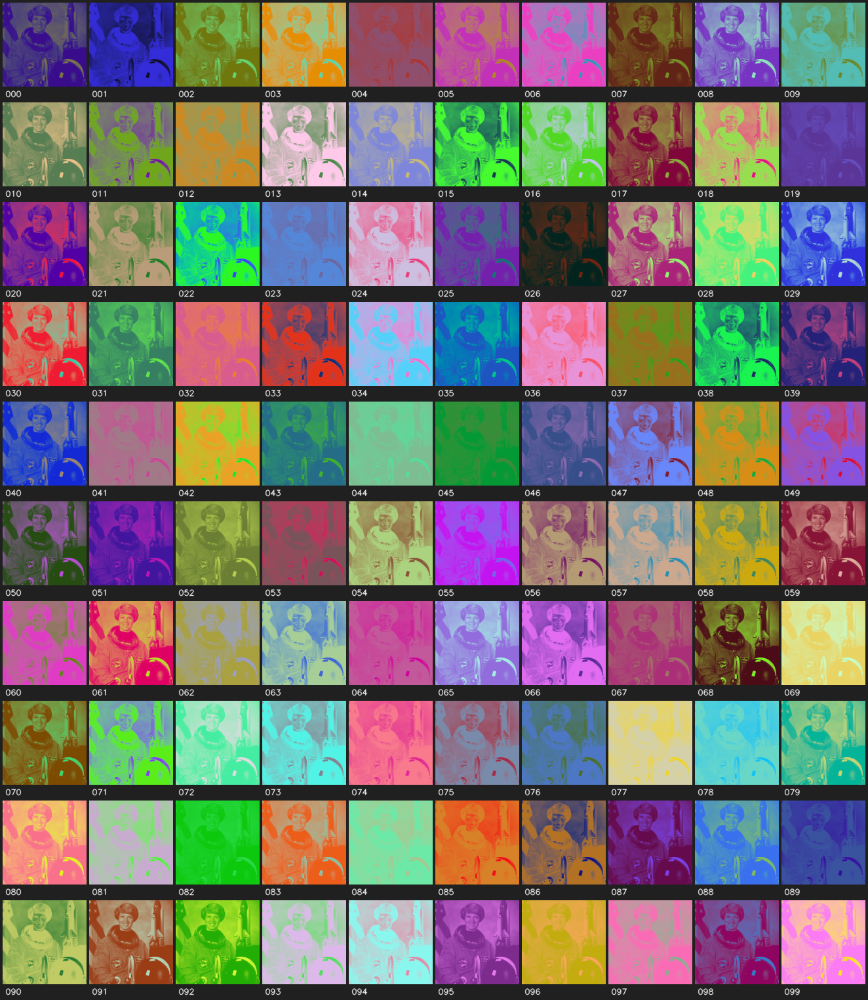

# Duotonics

[](https://github.com/MichailSemoglou/duotonics/actions/workflows/tests.yml)
[](https://github.com/MichailSemoglou/duotonics/blob/main/LICENSE)

Duotonics is a Python application for reproducible two-color imaging. It blends random or explicit color pairs over a source image's tonal key in gamma-encoded sRGB (legacy), linear sRGB, or Oklab (Ottosson, 2020). It accepts JPEG, PNG, and BMP input and writes a batch of lossless PNGs (100 by default) plus `colors.csv` and `metrics.csv` sidecars. The application is usable through file dialogs, a command-line interface, or as a Python library.

## Features

- Image selection via a file dialog
- Generates 100 duotone variations as lossless **PNG** files (count configurable)
- Filenames use **hex color codes** in RGB order (e.g. `083_2CD2B4_DC1E5A.png`), ready to paste into Figma, Illustrator, or your design system
- Produces a **`colors.csv` sidecar** listing every variation's color pair for easy reference and sharing
- Produces a **`metrics.csv` sidecar** reporting mean, median, and 95th-percentile CIEDE2000 (Sharma, Wu & Dalal, 2005) for every variation against its Oklab-rendered perceptual reference
- Command-line mode with reproducible batches (`--seed`), configurable variation count (`--count`), explicit color pairs (`--colors`), and blend space (`--space srgb|linear|oklab`)
- Uses OpenCV for efficient image processing

## Example batch

One source photograph, 100 duotone variations generated with `--count 100 --seed 42 --space oklab`:



Source: NASA's photograph of astronaut Eileen Collins, public domain, from the [scikit-image `astronaut` dataset](https://scikit-image.org/docs/stable/api/skimage.data.html#skimage.data.astronaut).

## Installation

Duotonics requires Python 3.9 or higher. Install it from a source checkout:

```bash
git clone https://github.com/MichailSemoglou/duotonics.git
cd duotonics
python -m pip install .
```

This installs the `duotonics` command and the `duotone_generator` Python module. After the PyPI release, installation will also be available with `python -m pip install duotonics`.

## Usage

### Interactive mode

Run the command without arguments:

```bash
duotonics
```

Direct script execution remains available from a source checkout:

```bash
python3 duotone_generator.py
```

1. A file dialog will open. Select the image you want to process, then choose an output directory.

2. The script will generate 100 duotone variations in a new folder named `[original_filename]_duotone_variations`. Each variation is a lossless PNG file named after its two hex color values (e.g. `083_2CD2B4_DC1E5A.png`). A `colors.csv` file is also written to the same folder, listing every variation's color pair.

3. A message box will appear when the process is complete, indicating the location of the output folder.

### Command-line mode

Pass the image path as an argument to run without any dialogs, suitable for scripting and headless environments:

```bash
duotonics path/to/image.png [--output-dir DIR] [--count N] [--seed S] [--colors "HEX1,HEX2"] [--space {srgb,linear,oklab}]
```

- `-o, --output-dir DIR`: place the output folder under DIR instead of alongside the source image.
- `--count N`: number of random variations (default: 100).
- `--seed S`: reproduce a batch exactly by reusing its seed.
- `--colors "#2CD2B4,#DC1E5A"`: apply explicit color pairs instead of random ones; repeatable, one variation per pair. Cannot be combined with `--count` or `--seed`.
- `--space {srgb,linear,oklab}`: where the blend runs. `srgb` (default) is the legacy gamma-space blend. `linear` blends linear light (IEC 61966-2-1; Poynton, 2003) and `oklab` blends in Oklab (Ottosson, 2020); both derive the key from ITU-R BT.709 relative luminance instead of grayscale luma.

The location of the output folder is printed on completion.

### Library use

The module can be imported and used as a library, without tkinter installed:

```python
from duotone_generator import convert_to_duotone

folder, records = convert_to_duotone("photo.png", count=25, seed=42, space="oklab")
```

It returns the output folder path and a list of `[index, color_1_hex, color_2_hex]` records, one per variation. Each batch also writes `metrics.csv`, whose rows report the mean, median, and 95th-percentile CIEDE2000 (Sharma, Wu & Dalal, 2005) between that variation and its perceptual reference, defined as the same color pair blended in Oklab over the same key. See the `convert_to_duotone` docstring for all parameters.

## Dependencies

- OpenCV (cv2)
- NumPy
- Tkinter (usually comes pre-installed with Python; only needed for interactive mode)

## Requirements

- Python 3.9 or higher

## Development

Install the package in editable mode with its development dependencies, then run the test suite with coverage:

```bash
python -m pip install -e . -r requirements-dev.txt
pytest --cov --cov-report=term-missing
```

Build and check the wheel and source distribution with:

```bash
python -m build
python -m twine check dist/*
```

## Community

- [Contribution guide](https://github.com/MichailSemoglou/duotonics/blob/main/CONTRIBUTING.md)
- [Code of conduct](https://github.com/MichailSemoglou/duotonics/blob/main/CODE_OF_CONDUCT.md)
- [Security policy](https://github.com/MichailSemoglou/duotonics/blob/main/SECURITY.md)

## License

MIT. See the [LICENSE](https://github.com/MichailSemoglou/duotonics/blob/main/LICENSE) file for details.
